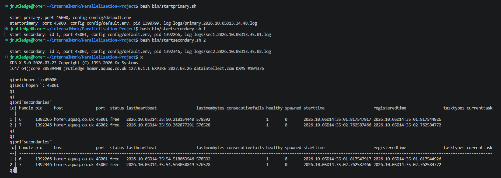

# Parallelisation-Project
Build a pure q parallelisation framework with a master proc that can spin up secondary procs to complete tasks. 

## Primary 
This is the main process which will manage secondaries and tasks

### how to start
Go to the directory and start this will run the default config and start on port `45000`

```bash
cd /home/jrutledge/internalWork/Parallelisation-Project
bash bin/startprimary.sh
```

For starting it interactively do 
```bash
bash config/config.sh     # this is jsut a coipy of deaful.coinfig and im doing it for testing atm, will probs move out
x src/primary.q -p 45000
```

### tables
**secondaries**

This is a table to monitor the secondary processes used for carrying out tasks assigned by the primary. In this table we track key information such as the `status` of a secondary process.

### Secondaries
These will either be ran as part of the intial start up or the primary will spin up more as needed. They will take the port number `PRIMARY_PORT` + `id` so `secondary 1` would have a port of `45001` and so on. A secondary cannot start if the primary process is not up.

We are going to set all secondaries `oom_score` to `1000`. For anyone not familiar with this `-1000` means shut me down last and `1000` means shut me down first in the case we are out of memory. You can check a processes `oom_score` using `cat /proc/<pid>/oom_score`.

### how to start
To bring up 2 secondaries run the below
```bash
cd /home/jrutledge/internalWork/Parallelisation-Project
bash bin/startsecondary.sh 1
bash bin/startsecondary.sh 2
```

## Testing
We will use the qspec testing framework here, i have copied it into the project directly

### how to run unit tests
From the project top level dir, you run the below commands
```bash
tests/run.sh tests/unit                     # a whole folder
tests/run.sh tests/unit/primarytests.q      # one file
```

Example run
```bash
jrutledge@homer:~/internalWork/Parallelisation-Project$ tests/run.sh tests/unit/primary.q 
.

For 1 specifications, 1 expectations were run.
1 passed, 0 failed.  0 errors.
jrutledge@homer:~/internalWork/Parallelisation-Project$ 
```

### how to run integration tests
From project top level dir run the below commands
```bash
bash tests/integration.sh oomscore   # run just the oomscore_spec.q test
bash tests/integration.sh            # run all integration tests
```
Example output
```bash
jrutledge@homer:~/internalWork/Parallelisation-Project$ bash tests/integration.sh

== tests/integration/stale_spec.q
..

For 1 specifications, 2 expectations were run.
2 passed, 0 failed.  0 errors.
tests/integration.sh: line 25: 2899594 Killed                  "$Q" src/primary.q -p "$PRIMARY_PORT" < /dev/null >> "$LOG_DIR/primary.log" 2>&1

== tests/integration/stop_spec.q
..

For 1 specifications, 2 expectations were run.
2 passed, 0 failed.  0 errors.
tests/integration.sh: line 25: 2899874 Killed                  "$Q" src/primary.q -p "$PRIMARY_PORT" < /dev/null >> "$LOG_DIR/primary.log" 2>&1

integration: all 2 spec files passed
jrutledge@homer:~/internalWork/Parallelisation-Project$ 
```


## Manual testing

A guide to manually test and run commands as i feel it give a bit of confidence to run the code yourself at times. It starts a primary with 4 secondaries and runs tasks through them.

### Start the primary
Go to the directory where you have downloaded hte project to and run the below
```bash
set -a; source config/default.env; set +a
export NUM_SECONDARYS=4
x src/primary.q -p 45000
```

Wait a couple of seconds until all 4 secondaries have registered:

```q
.primary.showstatus[]
```

You should see something like the below
```q
q).primary.showstatus[]
== primary status 2026.10.16D14:39:06.274222113  uptime 0D00:00:06.864868790 ==
secondaries: 4 free, 0 busy, 0 stale, 0 closed
id pid    port  status spawned lastseen     lastmembytes
--------------------------------------------------------
1  527736 45001 free   1       00:00:00.552 620432      
2  527741 45002 free   1       00:00:00.447 620432      
3  527746 45003 free   1       00:00:00.542 620432      
4  527750 45004 free   1       00:00:00.438 620432      
tasks: 0 queued, 0 dispatched, 0 running, 0 done, 0 failed
```

To watch the secondaries work, open a second terminal and follow today's secondary logs. You'll see a `task N is complete` line for each task:

```bash
tail -f logs/sec*.$(date +%Y.%m.%d)*.log
```

### 1. One task, end to end

```q
// run a task and record its taskid
t:.primary.newtask `tasktype`args!(`sumtil;1000000)
// look at the task you just ran
tasks t
// you should see all secondaries as free and tasks having 1 done
.primary.showstatus[]
```

If you increase the size of the argument to the task it will take longer so you can check the tasks and secondaries table to see different status's. This will also increase the `memafter` column as the `heap` will have increased.
eg.

```q
.primary.newtask `tasktype`args!(`sumtil;1000000000)
```

### 2. Many tasks: 20 one-second sleeps on 4 secondaries

```q
ids:.primary.newtask each ([] tasktype:20#`sleep; args:20#1)
```

You can perform the same checks as we did above when just running one task.


### 3. Priority: a high-priority task goes ahead of the queue

First fill all 4 secondaries with 5-second tasks, sleep for 2 seconds then send 4 low and 1 high priority task.

```q
.primary.newtask each ([] tasktype:4#`sleep; args:4#5); system"sleep 2"; lo:.primary.newtask each ([] tasktype:4#`sumtil; args:4#1000); hi:.primary.newtask `tasktype`args`priority!(`sumtil;1000;9i)
```

If we check the tasks table and when each task was dispatched we will see the high priority task was dispatched before the low priority ones.

```q
`dispatchedtime xasc select taskid, tasktype, priority, submittedtime, dispatchedtime from tasks
taskid tasktype priority submittedtime                 dispatchedtime               
------------------------------------------------------------------------------------
9      sumtil   9        2026.10.20D08:51:37.677650727 2026.10.20D08:51:37.678739277
1      sleep    0        2026.10.20D08:51:35.673197691 2026.10.20D08:51:37.679028709
2      sleep    0        2026.10.20D08:51:35.673400356 2026.10.20D08:51:37.679254365
3      sleep    0        2026.10.20D08:51:35.673533294 2026.10.20D08:51:37.679470841
4      sleep    0        2026.10.20D08:51:35.673653260 2026.10.20D08:51:38.696035079
5      sumtil   0        2026.10.20D08:51:37.677263059 2026.10.20D08:51:38.696375433
6      sumtil   0        2026.10.20D08:51:37.677406335 2026.10.20D08:51:38.696626593
7      sumtil   0        2026.10.20D08:51:37.677493443 2026.10.20D08:51:38.696865825
8      sumtil   0        2026.10.20D08:51:37.677572699 2026.10.20D08:51:42.995350280
```

# Benchmarking
trades table is on avg 5100 rows per day
## 1st run
Pri/Sec side:
1. we ran with 4 secondaries
2. `.log.info` was running
3. query was  
```q
alld:d where not null d:"D"$string key hsym `$getenv `HDB_DIR
d:alld where alld within 2014.09.12 2015.09.11
ids:.primary.newtask each ([] tasktype:(count d)#`vwap; args: d)
```
4. this took 1min 9secs (`0D00:01:09.599248039`)
```q
exec count i by state from tasks
raze exec first each result from tasks where state=`done  //result
exec (max finishedtime)-min startedtime from tasks
```
5. only difference is we dont get the result returned
6. dispatch ran every 1 second 

threads side:
1. started `x hdb -s 4`
2. ran much quicker
```q
rutledge@homer:~/internalWork$ x hdb/ -s 8
KDB-X 5.0 2026.07.23 Copyright (C) 1993-2026 Kx Systems
l64/ 64()core 385394MB jrutledge homer.aquaq.co.uk 127.0.1.1 EXPIRE 2027.03.26 dataintellect.com KXMS #104376

.task.vwap:{[d]  select vwap: size wavg price by date,sym from trades where date = d };
alld:d where not null d:"D"$string key hsym `$"/home/jrutledge/internalWork/hdb"
d:alld where alld within 2014.09.12 2015.09.11
startTime:.z.P; .task.vwap peach d ; .z.P-startTime
0D00:00:00.077755113
```

I believe the main difference is the `dispatch` job only running every second, as the first task took ` 0D00:00:00.001581139`

## 2nd run
pri/sec:
1. changed `dispatch` job to check every 0.01 seconds now
2. this has sped it up significantly to 6.5 seconds `0D00:00:06.500832005`

## 3rd run
threads:
1. startged with 8 threads
```q
rutledge@homer:~/internalWork$ x hdb/ -s 8
KDB-X 5.0 2026.07.23 Copyright (C) 1993-2026 Kx Systems
l64/ 64()core 385394MB jrutledge homer.aquaq.co.uk 127.0.1.1 EXPIRE 2027.03.26 dataintellect.com KXMS #104376

.task.vwap:{[d]  select vwap: size wavg price by date,sym from trades where date = d };
alld:d where not null d:"D"$string key hsym `$"/home/jrutledge/internalWork/hdb"
d:alld where alld within 2014.09.12 2015.09.11
startTime:.z.P; .task.vwap peach d ; .z.P-startTime
0D00:00:00.089224031
```

pri/sec:
1. Changed to run 8 secondary processes
2. changed teh `dispatch` to check every 0.0001 seconds
```q
f:{alld:d where not null d:"D"$string key hsym `$getenv `HDB_DIR ; d:alld where alld within 2014.09.12 2015.09.11; ids:.primary.newtask each ([] tasktype:(count d)#`vwap; args: d)}
f[]
exec (max finishedtime)-min startedtime from tasks
0D00:00:03.201173431
```

## 4th run
lets up the amount of data, with fakedb.q we ran
```q
makehdb[`:hdb; 365; 100; 1000000]
```

threads:
```q
.task.vwap:{[d]  select vwap: size wavg price by date,sym from trades where date = d };
alld:d where not null d:"D"$string key hsym `$"/home/jrutledge/internalWork/hdb"
d:alld where alld within 2014.09.12 2015.09.11
startTime:.z.P; .task.vwap peach d ; .z.P-startTime
0D00:00:00.307302246
```

pri/sec:
```q
q)f:{alld:d where not null d:"D"$string key hsym `$getenv `HDB_DIR ; d:alld where alld within 2014.09.12 2015.09.11; ids:.primary.newtask each ([] tasktype:(count d)#`vwap; args: d)}

exec (max finishedtime)-min startedtime from tasks
0D00:00:03.225075485
```

## 5th run
bump up the size of trades again
```
makehdb[`:hdb; 365; 100; 10000000]
// i ctrl+c 'ed this as it was taking ages and homer was tight for disk space
```
will do a smaller date range as i dont want to kill homer

threads (8)
```q
q).task.vwap:{[d]  select vwap: size wavg price by date,sym from trades where date = d };
q)alld:d where not null d:"D"$string key hsym `$"/home/jrutledge/internalWork/hdb"
q)startTime:.z.P; .task.vwap peach alld ; .z.P-startTime
0D00:00:00.643
```

pri/sec:
```q
f:{alld:d where not null d:"D"$string key hsym `$getenv `HDB_DIR ;.primary.newtask each ([] tasktype:(count alld)#`vwap; args: alld)}
f[]

exec (max finishedtime)-min startedtime from tasks
0D00:00:01.348516461
```

## change

after we added the below line to `.primary.taskupdate` so it would rerun after a task is complete instead of waiting for  `.primary.dispatch` to run in our `.timer.getalljobs[]` table.
```
 if[newstate in `done`failed; .primary.dispatch[]];
 ```
 This got the time to 0.939 seconds (`0D00:00:00.939179837`) with the same setup as the 5th run

# AI Usage
1. qspec installation
2. planning it out after i had an intial plan
    - was mostly good think it maybe went into too much detail for version 1
    - got some things i hadnt considered
3. bash scripting, for any bash scripts primary/secondary/testing
4. q usage
    - simpler tasks eg. creating tables
    - used it in the spawning functionality for spawning secondaries from the primary and the testing
    Worked well mostly with a couple of style fixes (reordering so less brackets) and redefining variable names eg. in qspec it used `before` as a variable and had used `value` in another instance


# my notes ignroe in any PR reviews till the end

```
jrutledge@homer:~/internalWork/Parallelisation-Project$ bash bin/startprimary.sh

start primary: port 45000, config config/default.env
startprimary: port 45000, config config/default.env, pid 1362094, log logs/primary.2026.10.05D13.29.29.log

jrutledge@homer:~/internalWork/Parallelisation-Project$ bash bin/startsecondary.sh 1
start secondary: id 1, port 45001, config config/default.env, pid 1362384, log logs/sec1.2026.10.05D13.29.34.log

jrutledge@homer:~/internalWork/Parallelisation-Project$ bash bin/startsecondary.sh 2
start secondary: id 2, port 45002, config config/default.env, pid 1362708, log logs/sec2.2026.10.05D13.29.37.log
jrutledge@homer:~/internalWork/Parallelisation-Project$ 
```

### q stuff
```q
pri:hopen `::45000

sec1:hopen `::45001
```
### create an images folder or stick them all under docs/images and look at referncing them better



## info on kernal memory
We can see the kernal mem stats at `/proc/<pid>/status` file

**VmRSS**: Resident memory, this is all the physical RAM a process occupies. Its is roughly `RssAnon + RssFile`.

**RssAnon**: RAM not backed by a file. For q essentially the heap pages actually in use. The kernal cannot drop it so its the memory that leads to swapping or the OOM killer. In q the `heap` is what has been promised and available but `RssAnon` is what the kernal has promised, so usually the `heap > RssAnon`.

**RssFile**: RAM holding file page eg. q binary, libs and mapped files. The kernal can drop and read it from disk again so it is not a real cost. This is different to `mmap` in q as this is only files q mapped where as `RssFile` has the binarys and libs.

**VmHWM**: The largest `VmRSS` has been since the process has started or the last reset. (this can be done by writing `5` to `/pric/<pid>/clear_refs`)

We are using these instead of `.Q.w[]` as we can read `/proc/<pid>/status` at any time and `RSS` is what the kernal enforces.


Too test `OOM` i might need to use `cgroups` this allows me to allocate a certain amount of RAM to my processes so they will be chosen to kill first if mem limits are reached

Claude steps

## Testing out-of-memory safely on homer (cgroups)

homer is shared, so anything that might run out of memory runs inside a **cgroup (control group)** with its own memory limit. When the limit is reached, the kernel kills a process **inside the cgroup** (a secondary, as they set `oom_score_adj=1000`) and nothing outside it is affected. Always use `MemorySwapMax=0`: homer already uses a lot of swap, and without it a cgroup at its limit would swap instead of being killed.

`systemd-run` doesn't know shell aliases, so use the full path to q (`$KDBX_HOME/bin/q`), not `x`.

To do this we edit the file `/proc/<pid>/cgroup` by changing the start to use `/sys/fs/cgroup`. This can be seen in the function `.cgroup.dir`.

In the files under our cgroup directory we have the following;
```bash
d=<cgroup_dir>
cat $d/memory.current      # bytes the whole cgroup is using right now (all its processes together)
cat $d/memory.max          # the limit: "max" means no limit
cat $d/memory.events       # counters: how often the limit was hit, and oom_kill
cat $d/cgroup.procs        # the pids in this cgroup
```

So we will edit the `memory.max` file, so every process started in the same cgroup will be subjected to this. Since we start the secondary processes from the primary they will be under the same cgroup. When `memory.current` reaches `memory.max` the kernal will look at which processes have the highest `oom_score` and kill them first. As we start all secondary processes with an `oom_score_adj`=1000 it kills secondary processes first. It will add 1 to `oom_kill` in that cgroups `memory.events`

### How does it decide which process to kill?

How bad a process is can be calculated
```bash
badness = the process's resident memory + its swap + its page tables      (in pages)
        + oom_score_adj × (total memory allowed ÷ 1000)
```

Which ever process has the highest `badness` will be killed first by the kernal.

### How to start the primary in a cgroup

```bash
cd ~/internalWork/Parallelisation-Project
set -a; source config/default.env; set +a
systemd-run --user --scope --unit=qfwoom -p MemoryMax=1G -p MemorySwapMax=0 $KDBX_HOME/bin/q src/primary.q -p 45000
```

### What the primary does when a secondary is killed for memory

At start the primary finds its cgroup (`/proc/<pid>/cgroup`) and remembers the
`oom_kill` count from that cgroup's `memory.events`. When a secondary's connection
closes, the primary reads the count again. If it has gone up, the secondary was
killed by the kernel: its task is marked `failed` with reason `oom` and is **not**
retried (`oom` is not in `RETRY_REASONS`), because it would only be killed again.
Otherwise the reason is `lost` and the task is retried as usual. Either way the
secondary is restarted (up to `RESPAWN_MAX`).

Outside a memory-limited cgroup the count stays 0, so every death is `lost`.

To see it happen:

```bash
set -a; source config/default.env; set +a
systemd-run --user --scope --unit=qfwoom -p MemoryMax=1G -p MemorySwapMax=0 $KDBX_HOME/bin/q src/primary.q -p 45000
```
```q
q)t:.primary.newtask `tasktype`args!(`hold;`mb`secs!(1500;10))
q)tasks[t]`state`reason`retrycount        / `failed`oom, 0i
q)system "cat ",.primary.cgroupdir,"/memory.events"   / oom_kill 1
q).primary.showstatus[]                   / that secondary is back, restarts 1
```
Always set `MemorySwapMax=0`: without it the kernel swaps the process instead of
killing it, and homer already uses a lot of swap.

